# 🎯 Skill: QA 360° Audit — Protocolo Universal de Testes & Auditoria

> **Princípio Central:** Um teste automatizado confiável não se limita a renderizar páginas ou clicar em "Cancelar". Ele executa o **ciclo de vida completo (CRUD)** com dados reais, intercepta exceções assíncronas no console e na rede, garante a destruição de dados residuais e gera relatórios visuais acionáveis.

Esta skill define as diretrizes técnicas universais, a especificação de parâmetros de linha de comando (CLI) e a arquitetura de testes aplicável a **qualquer ecossistema web ou de APIs** (Next.js, React, Vue, Express, FastAPI, Django, Laravel, NestJS, etc.).

---

## 🧭 1. O Paradigma: Teste Superficial vs. Teste Profundo 360°

```mermaid
flowchart TD
    subgraph FalhaComum["❌ O Falso Positivo (Teste Superficial)"]
        F1["Navega até a rota /dashboard"] --> F2["Verifica se a tela renderizou (HTTP 200)"]
        F2 --> F3["Abre modal e clica em 'Cancelar'"]
        F3 --> F4["Resultado: PASS (100% verde, 0 dados testados)"]
    end

    subgraph Teste360["✅ A Abordagem 360° (Ciclo Completo)"]
        T1["Preenche formulário com dados reais [QA-TEST-UUID]"] --> T2["Clica em Salvar / Submeter"]
        T2 --> T3["Intercepta requisição XHR/Fetch (Valida HTTP 200/201)"]
        T3 --> T4["Escuta Console (Detecta TypeError, Unhandled Rejection)"]
        T4 --> T5["Confirma persistência no DOM ou na API"]
        T5 --> T6["Tear-down: Exclui o dado criado (Zero Test Pollution)"]
    end
```



### Regras de Ouro:
1. **Nunca clicar em "Cancelar" para validar um modal:** Modais devem ser submetidos com dados válidos e inválidos.
2. **Monitorar a rede em tempo real:** Qualquer requisição XHR/Fetch com status $\ge 400$ ou resposta com erro de JSON durante o teste deve marcar o cenário como anomalia.
3. **Escutar o Console do Navegador:** Erros como `Cannot read properties of undefined` ou falhas de bundle devem quebrar o teste mesmo que a interface pareça estável.
4. **Isolamento e Limpeza (Zero Pollution):** Todo registro criado deve usar um prefixo rastreável (ex: `QA-RUN-{UUID}`) e ser excluído no teardown do teste.

---

## ⚙️ 2. Especificação Universal de Parâmetros (CLI Spec)

Qualquer script ou runner de suíte 360° deve adotar os seguintes parâmetros padronizados:

| Parâmetro | Tipo | Padrão | Descrição |
|---|---|---|---|
| `--target-url` | `string` | `http://localhost:3000` | URL base da aplicação sob teste (local, staging ou produção). |
| `--auth-user` | `string` | *(Opcional)* | E-mail ou usuário para autenticação automática no início da suíte. |
| `--auth-password` | `string` | *(Opcional)* | Senha do usuário de teste. |
| `--headless` | `flag` | `False` | Execução silenciosa em segundo plano (ideal para CI/CD e esteiras). |
| `--slow-mo` | `int` | `0` | Atraso em milissegundos entre ações (ex: `200` para inspeção visual humana). |
| `--scenario` | `int/string`| `all` | Executa apenas o cenário específico pelo ID ou nome. |
| `--filter` | `regex` | `""` | Filtra cenários por padrão de texto no nome ou tags. |
| `--clean-only` | `flag` | `False` | Executa exclusivamente a rotina de purga/limpeza de dados residuais de teste. |
| `--only-security`| `flag` | `False` | Executa apenas os gates de segurança (secrets, dependências, SAST). |
| `--report-dir` | `path` | `./qa_reports` | Diretório de destino dos artefatos (HTML, JSON e prints de tela). |

---

## 🏗️ 3. As 5 Frentes da Arquitetura de Testes 360°

```
+-------------------------------------------------------------------------+
|                       SUÍTE DE AUDITORIA 360°                           |
+-------------------------------------------------------------------------+
| 1. AUTENTICAÇÃO    | Login, Emissão de Token/Cookie, RBAC, Expiração     |
| 2. FORMULÁRIOS     | Validação de Campos, Toasts, Limites, Erros          |
| 3. CICLO CRUD      | Create -> Read/Filter -> Update -> Delete (Tear-down)|
| 4. TELEMETRIA      | Network Monitor (4xx/5xx), Console Errors, Latência  |
| 5. HIGIENIZAÇÃO    | Varredura e Purga Automática de Registros Residuais |
+-------------------------------------------------------------------------+
```

### Frente 1: Autenticação & Sessão
- Valida o fluxo de login e rejeição de credenciais incorretas (HTTP 401).
- Confirma persistência segura da sessão (token JWT em `localStorage` ou cookies `HttpOnly`).
- Testa o controle de acesso baseado em papéis (RBAC): rotas administrativas bloqueadas para usuários comuns (HTTP 403 / Redirecionamento).

### Frente 2: Formulários & Submissões Reais
- Valida campos obrigatórios e máscaras de entrada (e-mails, números, documentos).
- Simula submissão com dados inválidos (verificando se o backend/frontend exibe mensagem amigável sem quebrar a tela).
- Submete formulário com dados válidos e aguarda o fechamento do modal ou retorno à listagem.

### Frente 3: Ciclo Completo de Dados (CRUD E2E)
- **Create:** Cadastra um novo registro com nome dinâmico (ex: `QA-Entity-8472`).
- **Read:** Localiza o registro na listagem/tabela e valida os campos exibidos.
- **Update:** Edita ao menos uma propriedade e verifica a atualização no DOM.
- **Delete:** Exclui o registro criado e confirma que ele não aparece mais nas consultas.

### Frente 4: Telemetria & Monitoramento Ativo
- **Console Listener:** Registra todas as mensagens enviadas ao `console.error` ou `console.warn`.
- **Network Listener:** Monitora requisições XHR/Fetch. Se qualquer chamada retornar `>= 400` ou retornar HTML quando a rota esperava JSON, o teste falha com alerta explícito.
- **Latência de Resposta:** Cronometra a duração de cada cenário para detecção de gargalos de performance.

### Frente 5: Higienização & Purga de Dados de Teste
- Todo teste implementa bloco `try ... finally` para garantir que a exclusão ocorra mesmo se uma asserção falhar no meio.
- Disponibiliza uma rotina de varredura global (`clean_residual_data`) que identifica todos os registros iniciados com o prefixo `QA-` e os remove do banco ou via API.

---

## 📊 4. Padrão de Relatórios (HTML Autônomo + JSON)

Após a execução, a suíte deve gerar dois artefatos:

1. **Relatório Visual HTML (`qa_reports/relatorio_execucao.html`):**
   - Arquivo único sem dependências externas de CDN (funciona offline).
   - Cabeçalho com métricas: Total de Cenários, Taxa de Sucesso, Tempo Total e Erros de Console.
   - Cards por cenário com status (Aprovado / Falha), duração e logs detalhados.
   - Screenshots automáticos capturados no momento exato do erro.

2. **Resumo Estruturado JSON (`qa_reports/resumo.json`):**
   - Utilizado por pipelines de CI/CD para bloquear deploys em caso de regressão:
   ```json
   {
     "target_url": "https://app.exemplo.com",
     "timestamp": "2026-11-02T22:00:00Z",
     "total_scenarios": 16,
     "passed": 16,
     "failed": 0,
     "console_errors": 0,
     "duration_seconds": 124.5,
     "scenarios": [
       { "id": "01", "name": "Autenticação & Sessão", "status": "PASS", "duration": 8.2 }
     ]
   }
   ```

---

## 💻 5. Template de Implementação Universal (Python + Playwright)

Qualquer projeto pode utilizar este modelo base adaptando apenas as rotas e seletores:

```python
#!/usr/bin/env python3
"""
Template Universal de Testes 360° — Playwright
Compatível com qualquer aplicação web.
"""

import sys
import time
import argparse
from playwright.sync_api import sync_playwright

class UniversalQASuite:
    def __init__(self, base_url: str, headless: bool = True, slow_mo: int = 0):
        self.base_url = base_url.rstrip("/")
        self.headless = headless
        self.slow_mo = slow_mo
        self.console_errors = []
        self.network_errors = []
        self.results = []

    def setup_listeners(self, page):
        """Intercepta erros de console e falhas de rede."""
        page.on("console", lambda msg: self.console_errors.append(f"[{msg.type}] {msg.text}") if msg.type == "error" else None)
        page.on("response", lambda res: self.network_errors.append(f"{res.status} {res.url}") if res.status >= 400 else None)

    def run_scenario(self, name: str, test_fn):
        """Executa um cenário com cronometragem e captura de falhas."""
        print(f"\n🔹 Executando: {name}...")
        start = time.time()
        status = "FAIL"
        error_msg = ""
        try:
            test_fn()
            status = "PASS"
            print(f"  ✅ [PASS] {name} ({time.time() - start:.2f}s)")
        except Exception as e:
            error_msg = str(e)
            print(f"  ❌ [FAIL] {name}: {error_msg}")
        finally:
            self.results.append({
                "name": name,
                "status": status,
                "duration": time.time() - start,
                "error": error_msg
            })

    def run(self):
        with sync_playwright() as p:
            browser = p.chromium.launch(headless=self.headless, slow_mo=self.slow_mo)
            context = browser.new_context(viewport={"width": 1280, "height": 720})
            page = context.new_page()
            self.setup_listeners(page)

            # Exemplo de Cenário 1: Autenticação
            self.run_scenario("Handshake Inicial & Rota Base", lambda: page.goto(self.base_url))

            browser.close()

if __name__ == "__main__":
    parser = argparse.ArgumentParser(description="Runner Universal de Testes 360°")
    parser.add_argument("--url", default="http://localhost:3000", help="URL base")
    parser.add_argument("--headless", action="store_true", help="Modo headless")
    parser.add_argument("--slow-mo", type=int, default=0, help="Velocidade em ms")
    args = parser.parse_args()

    suite = UniversalQASuite(args.url, args.headless, args.slow_mo)
    suite.run()
```

